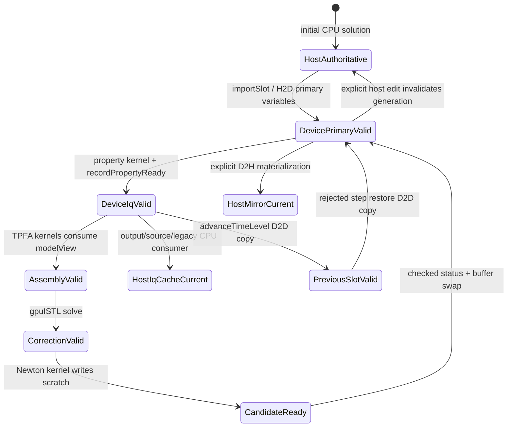

# PR 7462: GPU bridges — architecture and code-quality review

Date: 2026-09-28  
Review basis: `master...58c828702` (`all_gpu_bridges_1`), 38 files, 3,890 additions, 915 deletions  
Pull request: [OPM/opm-simulators#7462](https://github.com/OPM/opm-simulators/pull/7462)

## Executive summary

The PR implements three linked bridges, not one:

1. **Property evaluation to TPFA assembly.** `GpuBlackoilIntensiveQuantitiesDispatcher` creates and owns a `GpuFlowGasWaterEnergyBridge`. The bridge keeps current and previous primary variables and intensive quantities on the device. `TpfaLinearizerGpuParams` borrows typed views of those intensive quantities instead of rebuilding a GPU model from the CPU cache.
2. **TPFA assembly to gpuISTL.** `TpfaLinearizer` exposes its device-resident Jacobian and residual. `ISTLSolverRuntimeOptionProxy` recognizes gpuISTL and passes these objects to `ISTLSolverGPUISTL`, which can borrow an externally owned GPU matrix and copy only device-to-device for the right-hand side.
3. **gpuISTL to Newton update and back to properties.** The linear correction is written into bridge-owned device storage. `GpuBlackoilNewtonUpdate` applies stabilization and shared black-oil update physics into scratch buffers. After a 16-byte status download succeeds, the bridge swaps scratch and authoritative buffers and reruns property evaluation without downloading the solution.

That architecture removes the dominant matrix, correction, primary-variable, and intensive-quantity round trips from the supported steady-state nonlinear iteration. It does **not** make the whole simulation device-resident: convergence still downloads the residual and compact per-cell data; source terms, output, serialization, diagnostics, unsupported solver modes, wells, MPI, and rollback compatibility still cross to the host.

The design is directionally sound and follows the repository's owning-buffer/non-owning-view model. It is not ready to merge in its current form. The most urgent problems are an unrelated output regression (`EconomicLimitsMessage.hpp` returns the literal `"placeholder"` for every date), no dedicated end-to-end bridge/Newton/rollback tests, all seven new files failing the required clang-format check, and non-compliant copyright headers. The host/device authority protocol also relies on manually marking every host mutation, which is too fragile for a widely used `solution()` API.

The PR description reports a 2x speedup on a 270k-cell SPE11C case. This review did not independently reproduce that benchmark.

## Supported path and activation conditions

The full resident path is narrower than the names suggest. It currently requires:

- the `FlowGasWaterEnergyProblem` or `FlowGasWaterEnergyProblemGPU` TypeTag;
- gas + water + energy (CO2STORE-compatible), no active oil phase;
- piecewise-linear saturation functions;
- SPECROCK solid energy and THCONR thermal conduction;
- no diffusion, dispersion, hysteresis, endpoint scaling, directional relperms, dynamic rock compaction, schedule actions, GEO_MODIFIER, or time-dependent VAPPARS/DRSDT/DRVDT inputs;
- GPU TPFA assembly and the gpuISTL runtime backend;
- one MPI rank, no wells, ordinary unconstrained Newton, no NLDD, and no hybrid Newton for the resident update.

The property bridge alone can be enabled without the resident Newton update, but unsupported physics is rejected in `validateGpuPropertyInputs()` (`GpuBlackoilIntensiveQuantitiesDispatcher.cu:96-161`). The final resident-update predicate is in `NonlinearSystemBlackOilReservoir_impl.hpp:273-299`.

## UML: structure and ownership

The following Mermaid class diagram uses composition for owners and dependency arrows for borrowed views. It is intentionally explicit about ownership because that is the central correctness rule in the GPU architecture guide.

```mermaid
classDiagram
    direction LR

    class FIBlackOilModel {
        +invalidateAndUpdateIntensiveQuantities(timeIdx)
        +evaluateResidentProperties(timeIdx)
        +gpuPropertyAssemblyBridge()
        +ensureHostIntensiveQuantities(timeIdx)
        +ensureHostPrimaryVariables(timeIdx)
    }

    class GpuBlackoilIntensiveQuantitiesDispatcher {
        +update(problem, solution, timeIdx)
        +evaluateResident(timeIdx)
        +applyNewtonUpdate(...)
        +computeTrueImpesWeights(...)
        +bridge()
    }

    class GpuFlowGasWaterEnergyBridge {
        +GpuBuffer primaryVariables[2]
        +GpuBuffer intensiveQuantities[2]
        +GpuVector correction
        +GpuVector previousCorrection
        +GpuBuffer scratchPrimaryVariables
        +GpuBuffer switchHistory
        +GpuBuffer updateStatus
        +GpuProblemBuffer problem
        +FluidSystemBuffer fluidSystem
        +recordPropertyReady(timeIdx)
        +waitForAssembly(timeIdx)
        +orderSolverAfterProperties()
        +orderUpdateAfterSolver()
        +commitDeviceUpdate(timeIdx)
    }

    class TpfaLinearizer {
        +linearize_()
        +gpuJacobian()
        +flattenedGpuResidual()
    }

    class TpfaLinearizerGpuParams {
        +GpuSparseMatrixWrapper* gpuJacobian
        +GpuBuffer residual
        +GpuVector flattenedResidual
        +modelView()
        +refreshForLinearization()
    }

    class ISTLSolverRuntimeOptionProxy {
        +prepareGpu(matrix, rhs)
        +solveGpu(correction)
        +hasGpuSolver()
    }

    class ISTLSolverGPUISTL {
        +prepare(GPUMatrix, GPUVector)
        +solve(GPUVector)
        -GPUMatrix* externalMatrix
        -GPUVector rhs
    }

    class GpuBlackoilNewtonUpdate {
        +launchBlackoilNewtonUpdate(...)
        +blackoilNewtonUpdateKernel(...)
    }

    class BlackOilNewtonUpdate {
        +update(problem, fluidSystem, cell, next, current, delta, params, switched) bool
    }

    FIBlackOilModel *-- GpuBlackoilIntensiveQuantitiesDispatcher : owns lazily
    GpuBlackoilIntensiveQuantitiesDispatcher *-- GpuFlowGasWaterEnergyBridge : owns
    TpfaLinearizer *-- TpfaLinearizerGpuParams : owns
    TpfaLinearizerGpuParams ..> GpuFlowGasWaterEnergyBridge : borrows IQ/model views
    TpfaLinearizer ..> ISTLSolverRuntimeOptionProxy : exposes matrix/residual
    ISTLSolverRuntimeOptionProxy *-- ISTLSolverGPUISTL : runtime-selected owner
    ISTLSolverGPUISTL ..> TpfaLinearizerGpuParams : borrows external matrix
    GpuBlackoilNewtonUpdate ..> GpuFlowGasWaterEnergyBridge : reads correction, writes scratch
    GpuBlackoilNewtonUpdate ..> BlackOilNewtonUpdate : shared CPU/GPU physics
```



### Ownership interpretation

- `GpuFlowGasWaterEnergyBridge` is the long-lived owner of property and Newton state. Its `GpuBuffer`/`GpuVector` objects satisfy the guide's RAII ownership rule (`GpuFlowGasWaterEnergyBridge.hpp:896-916`).
- Kernels receive `GpuView` or small view objects by value. Assembly's `SimpleFIBlackOilModel<..., GpuView>` is created by `modelView()` (`GpuFlowGasWaterEnergyBridge.hpp:474-480`).
- `TpfaLinearizerGpuParams::propertyAssemblyBridge_` and `ISTLSolverGPUISTL::m_externalMatrix` are non-owning raw pointers. Their lifetime assumptions are documented, but the type system does not enforce them.
- Static fluid/material/thermal/problem data is uploaded once when the bridge is initialized (`GpuFlowGasWaterEnergyBridge.hpp:623-695`). Device buffers are rebuilt only when the number of degrees of freedom changes.

## UML: one resident nonlinear iteration

```mermaid
sequenceDiagram
    autonumber
    participant N as NonlinearSystemBlackOilReservoir
    participant M as FIBlackOilModel
    participant D as IQ Dispatcher
    participant B as GPU State Bridge
    participant T as TpfaLinearizer/GpuParams
    participant S as gpuISTL
    participant U as GPU Newton Kernel

    N->>M: initialLinearization()
    M->>D: evaluateResident(0)
    D->>B: primaryVariablesView(0), IQ view(0)
    D-->>B: property kernel on bridge stream
    D->>B: recordPropertyReady(0)

    N->>T: linearizeDomain()
    T->>B: waitForAssembly(0)
    Note over B,T: event orders default-stream TPFA after property stream
    T->>B: modelView() borrows IQ[0], IQ[1], volumes
    T-->>T: TPFA + BC kernels write GPU Jacobian/residual
    T-->>T: CPU source evaluation; upload sparse deltas
    T-->>N: D2H residual for convergence report

    N->>B: orderSolverAfterProperties()
    N->>S: prepareGpu(gpuJacobian, flattenedResidual)
    Note over T,S: matrix is externally owned; RHS is D2D-copied
    N->>S: solveGpu(bridge.correction)
    S-->>B: correction remains on device
    N->>B: orderUpdateAfterSolver()

    N->>D: applyNewtonUpdate(...)
    D->>U: launch with current PV, correction, history, scratch
    U-->>B: candidate PV + candidate switch history + status
    D->>B: readUpdateStatus()
    Note over D,B: 16-byte D2H copy and stream synchronization
    alt update successful
        D->>B: commitDeviceUpdate()
        Note over B: swap current/scratch; invalidate IQ[0]
        N->>D: evaluateResident(0)
        D-->>B: refreshed IQ stays on device
    else update failed
        D-->>N: throw NumericalProblem
        Note over B: authoritative PV/history were never partially published
    end
```

This is a transactional Newton update: kernels write candidates, the host reads only compact status, and `commitDeviceUpdate()` publishes the candidate by swapping owners. That is one of the strongest parts of the design.

## UML: authoritative-state transitions



Generation counters (`primaryGeneration_`, `hostPrimaryGeneration_`, and `iqGeneration_`) encode these states. An IQ slot is consumable only when its generation matches the primary-variable generation (`GpuFlowGasWaterEnergyBridge.hpp:505-513`).

## Dataflow by simulation phase

| Simulation phase | Producer | Data and location | Consumer | Transfer/synchronization |
|---|---|---|---|---|
| First GPU property request | CPU model/problem | Fluid system, material/thermal laws, volumes, two PV/IQ slots | `GpuFlowGasWaterEnergyBridge` | One-time H2D uploads and persistent allocations |
| Property evaluation | `dispatcherUpdateAllCellsKernel` | `IQ[timeIdx]` on bridge stream | TPFA and compact convergence/CPR kernels | Event recorded; no host copy |
| TPFA assembly | `TpfaLinearizer` kernels | GPU sparse Jacobian and block residual | gpuISTL | Matrix borrowed; residual flattened D2D |
| Source contribution | CPU `FlowProblemBlackoil`/linearizer | Sparse residual/Jacobian deltas | GPU assembly buffers | Per-source host calculation, then small H2D delta uploads; energy source may D2H one IQ |
| Convergence | GPU residual + compact IQ factors | Host residual, `numCells * numEq` factors | convergence report | Bulk D2H remains each relevant iteration |
| Linear solve | gpuISTL | correction in bridge-owned `GpuVector` | Newton kernel | Device-resident; default-stream/bridge-stream events |
| Newton update | `blackoilNewtonUpdateKernel` | scratch PV/history plus 4-word status | bridge commit | 16-byte D2H status; no PV/correction copy in normal mode |
| Next property pass | property kernel | new `IQ[0]` | next assembly | Device-resident |
| Relative-change check | compact GPU kernel | two scalars per cell | host reduction | `2 * numCells * sizeof(Scalar)` D2H |
| Time-level advance | bridge | PV/IQ slot 0 to slot 1 | next time step | D2D copies; host history becomes a lazy mirror |
| Rejected step | bridge | previous PV slot to current slot | property kernel | D2D restore; correction history reset |
| Output/serialization/legacy CPU code | bridge | full PV or IQ slot | CPU cache/solution | Explicit synchronized D2H boundary |

## Where the bridging is implemented

### 1. Shared device type contract

`GpuFlowGasWaterEnergyContract.hpp` defines one `FlowGasWaterEnergyDeviceTypeTag<Storage>` mapping for both property evaluation and TPFA. It binds:

- `BlackOilPrimaryVariables<..., MiniVector>`;
- `BlackOilFluidSystemNonStatic<..., Storage>`;
- device-view material and thermal law managers;
- `GpuFlowProblem`;
- unsupported modules disabled at compile time.

This fixes the earlier risk that property and assembly paths instantiated layout-compatible-looking but actually different intensive-quantity types. The static assertions in `GpuFlowGasWaterEnergyBridge.hpp:102-104` enforce the agreement.

### 2. Property-to-assembly bridge

`FIBlackOilModel::invalidateAndUpdateIntensiveQuantities()` selects the dispatcher (`FIBlackoilModel.hpp:141-167`). The dispatcher imports host primary variables only at an authority boundary and launches one property thread per cell (`GpuBlackoilIntensiveQuantitiesDispatcher.cu:350-375`, `429-444`).

For GPU assembly, `TpfaLinearizerGpuParams` stores a non-owning pointer to the model-owned bridge (`tpfalinearizergpuparams.hh:143-170`). On first construction it selects either:

- the direct path: borrow `modelView()` and the bridge's device fluid system (`245-251`); or
- the legacy fallback: materialize CPU IQs and build separate GPU fluid/model buffers (`254-274`).

Each later linearization calls `waitForAssembly()` and clears only the residual (`277-293`). TPFA then consumes `gpuParams_->modelView()` (`tpfalinearizer.hh:947-985`).

### 3. Assembly-to-linear-solver bridge

When GPU assembly, gpuISTL, and no global wells coincide, `TpfaLinearizer` leaves the Jacobian authoritative on the device and downloads only the residual needed by convergence (`tpfalinearizer.hh:988-997`). It exposes `gpuJacobian()` and `flattenedGpuResidual()`.

`ISTLSolverRuntimeOptionProxy::prepareGpu()` dynamically identifies `ISTLSolverGPUISTL` (`ISTLSolverRuntimeOptionProxy.hpp:137-185`). The gpuISTL overload stores a non-owning external matrix pointer and D2D-copies the residual into solver storage (`ISTLSolverGPUISTL.hpp:224-250`). The resident `solve(GPUVector&)` leaves the correction on device (`349-359`).

### 4. Solver-to-Newton/property bridge

`NonlinearSystemBlackOilReservoir::nonlinearIterationNewton()` chooses the resident path and connects the linearizer, solver, bridge correction, and update dispatcher (`NonlinearSystemBlackOilReservoir_impl.hpp:273-320`, `383-405`).

The CPU Newton formula was extracted into `BlackOilNewtonUpdate<TypeTag>` and is called from both `BlackOilNewtonMethod` and the GPU kernel. This is exactly the right way to avoid duplicated physics. The GPU kernel additionally performs correction stabilization and writes candidates transactionally (`GpuBlackoilNewtonUpdate.cu:83-167`).

### 5. Explicit compatibility boundaries

`FIBlackOilModel` guards legacy CPU consumers through:

- `ensureHostIntensiveQuantities()` for a whole IQ slot or one source cell (`FIBlackoilModel.hpp:305-370`);
- `ensureHostPrimaryVariables()` for the solution mirror (`372-384`);
- serialization and equality hooks in `FvBaseDiscretization`;
- output synchronization in `EclWriter`;
- compact GPU kernels for convergence, relative change, rock-compaction history, and true-IMPES weights.

These boundaries make transfers visible and measurable, which is preferable to implicit copies from every accessor.

## Alignment with the GPU architecture guide

### What is done well

- **Owning buffer / non-owning view separation:** the bridge owns `GpuBuffer`/`GpuVector`; kernels consume `GpuView` values.
- **Lifetime:** the dispatcher is model-owned, so assembly cannot outlive its property/IQ data. The bridge destructor orders outstanding default-stream and bridge-stream work before releasing buffers.
- **Edit shared physics, do not duplicate:** the black-oil Newton cell update is extracted into one `OPM_HOST_DEVICE` implementation used by CPU and GPU. `BlackOilPrimaryVariables` is adapted in place rather than cloned.
- **Non-static fluid system:** static CPU fluid data is converted through `getNonStaticInstance()`, `copy_to_gpu()`, and `make_view()`.
- **CUDA/HIP routing:** new `.cu` and public headers are registered with `ADD_CUDA_OR_HIP_FILE`; the Newton translation unit alone disables FP contraction.
- **Exceptions and formatting:** new exception sites use `OPM_THROW`; runtime messages use `std::format`.
- **No steady-state bulk transfer invariant:** the resident Newton path checks counters after each committed update and throws if it uploaded PVs, downloaded corrections, or allocated bridge buffers.

### Where it diverges or remains fragile

- The architecture guide requires every new file to be clang-formatted. All seven new files fail `clang-format --dry-run --Werror --style=file:.clang-format`.
- New-file copyright headers do not use the required `Copyright TODO ADD YEAR AND NAME OF AUTHOR` template; several are abbreviated and omit required GPL paragraphs.
- The bridge is a 924-line owner/synchronization/transfer/validation/accounting class. It is not duplicated physics, so creating it is defensible, but its responsibilities are too broad.
- Host/device authority depends on callers manually invoking `markHostPrimaryVariablesModified()`. A non-const `solution()` reference does not mark mutation. Missing one call site can silently retain stale device state.
- The `GpuFlowGasWaterEnergyContract` is shared correctly, but both GPU `.cu` files still include large Flow/TPFA/nonlinear header graphs. That coupling is what makes unrelated host-only code visible to hipcc and appears to have motivated the economic-date workaround.
- Several public query functions that return meaningful status (`hasBridge`, `hasModelView`, `hasIntensiveQuantities`, `prepareGpu`, `solveGpu`) are good candidates for `[[nodiscard]]`.

## Findings and recommended changes

### Blockers

1. **Restore economic-limit date formatting and remove the unrelated placeholder.**  
   `EconomicLimitsMessage.hpp:42-45` changes every date to `"placeholder"`. This is a user-visible regression unrelated to GPU bridges. The correct fix is to keep this host-only header out of hipcc's device compilation path, or isolate the date-format implementation in a host `.cpp`; do not change its behavior in this PR.

2. **Format all new files.**  
   Run clang-format with `opm-simulators/.clang-format` on the seven added files. Existing files should retain local style, but touched blocks should be cleaned where practical. `git diff --check` currently passes, which checks whitespace only and is not a substitute for clang-format.

3. **Fix new-file licensing.**  
   Apply the exact header mandated by `AGENTS.md`, including `Copyright TODO ADD YEAR AND NAME OF AUTHOR`, to every added file.

4. **Add bridge-level tests before treating the reported speedup path as safe.**  
   The only changed Boost test verifies dispatcher materialization and adds TypeTag mappings. There is no automated test for:

   - property kernel -> TPFA using the same resident IQ storage;
   - GPU assembly -> externally owned gpuISTL matrix/RHS;
   - solver correction -> transactional Newton commit;
   - failed/non-finite update leaving authoritative PV/history untouched;
   - `advanceTimeLevel()` and `restorePreviousSolution()`;
   - host edit invalidation and lazy rematerialization;
   - one-shot rejected time step;
   - transfer-counter invariants in a complete iteration;
   - CUDA and HIP parity.

   Add a focused Boost GPU test for the bridge state machine and a small end-to-end `flow_gpu` regression deck. Register it for both CUDA/HIP and give it the GPU CTest label as required by the guide.

### High-priority architecture improvements

5. **Replace manual mutation marking with an explicit edit API.**  
   Introduce a scoped host edit, for example `auto edit = model.editSolution(timeIdx)`, whose destructor invalidates the device generation, or split read-only `solution()` from a clearly named mutation accessor. Keep `ensureHostPrimaryVariables()` inside the read accessor. This removes scattered edits from `FvBaseDiscretization`, `BlackOilModel`, `FlowProblemBlackoil`, and serialization code and makes stale-device bugs harder to introduce.

6. **Split bridge responsibilities without changing physics classes.**  
   Keep one public facade but separate private components:

   - `GpuPrimaryState` — two PV slots, generations, rollback, host mirror;
   - `GpuIntensiveQuantityCache` — two IQ slots and materialization;
   - `GpuNewtonState` — correction/history/scratch/status and transactional commit;
   - `GpuStreamHandoffs` — events and stream ordering;
   - optional diagnostics/accounting outside the production owner.

   This retains the guide's single source of physics while making invariants testable in isolation.

7. **Use lifetime-bearing handles instead of raw borrowed pointers.**  
   Replace `TpfaLinearizerGpuParams::propertyAssemblyBridge_` with a small non-null borrowed-reference wrapper, and make externally owned matrix mode an explicit solver state/variant rather than `m_externalMatrix`. At minimum, delete move operations where pointer stability is assumed and assert owner identity in every prepare call.

8. **Reduce GPU translation-unit include graphs.**  
   Extract explicit-instantiation declarations and lightweight device contracts so `GpuBlackoilNewtonUpdate.cu` does not need full `tpfalinearizer.hh`, `FlowProblemBlackoil.hpp`, and unrelated output/well code. This both improves compile times and avoids hipcc workarounds in host-only files.

9. **Centralize feature gating and report why a path is inactive.**  
   The same conditions are distributed among input validation, `TpfaLinearizer`, `FIBlackOilModel`, and `NonlinearSystemBlackOilReservoir`. Create one capability object or function returning `{enabled, reason}` for property, assembly-solver, and resident-Newton levels. Use it for logging and tests.

10. **Avoid duplicate GPU problem/static-data owners.**  
    The property bridge owns a `GpuFlowProblem`, while `TpfaLinearizerGpuParams` owns a separate `ThermalGasWaterFlowProblem` for assembly. If their data cannot be unified, name them according to role and document why. If they can, expose narrowly typed views from one persistent static-data owner to avoid duplicate uploads and lifetime paths.

### Changes that should be split or minimized

11. **Move unrelated well/source-only optimizations to prerequisite PRs.**  
    The changes that skip average formation-factor/rate-converter work when there are no wells, the early return in `updateExplicitQuantities_()`, and the economic-date workaround are not the bridges themselves. Splitting valid source-only prerequisites into a small reviewed PR would reduce the current 38-file surface and make performance attribution clearer.

12. **Contain generic Newton changes behind an adapter.**  
    `newtonmethod.hh` now knows about `RunAssemblyOnGpu`, `gpuJacobian()`, and `flattenedGpuResidual()`, while Flow's `NonlinearSystemBlackOilReservoir` has another GPU solve path. A `LinearSystemView`/solver adapter with host and device implementations would keep the generic Newton algorithm unaware of GPU-specific members and eliminate parallel bridging logic.

13. **Keep compatibility materialization APIs narrow.**  
    `materializeHostPrimaryVariables(timeIdx, destination)` tracks whether the canonical host mirror is current, not whether an arbitrary destination has been populated. Either make the destination the model's canonical solution by construction, or always copy the current host mirror to the supplied destination. The current public signature permits a fresh destination to remain untouched when `hostPrimaryVariablesCurrent()` is true.

14. **Move validation and verbose diagnostics out of production classes/TUs where possible.**  
    Synthetic Newton branch validation, roundoff/PVT diagnostics, environment-variable validation, and transfer reporting add substantial production code and dependencies. Keep compact invariant counters in production, but place detailed comparison code in tests or a separately compiled diagnostic component.

15. **Add `[[nodiscard]]`, constness, and clearer names.**  
    Mark status-bearing getters and solver results `[[nodiscard]]`; make simple accessors `const` where possible; prefer names such as `numberOfDegreesOfFreedom`, `intensiveQuantities`, and `primaryVariables` in new APIs over new abbreviations. Domain-standard `GPU`, `CPU`, `IQ`, and `DoF` are reasonable exceptions.

### Clang-tidy findings and concrete fixes

The ROCm-matched clang-tidy (`AMD LLVM 23`) was run with the build compile database and the repository `.clang-tidy`. The generated HIP units were checked directly, and the Flow unit was rerun with a focused header filter for the new bridge/shared-Newton headers. It reports 12 enabled-check findings at nine source locations (three C-array locations are each diagnosed by two enabled checks):

| Source | Check | Recommended fix |
|---|---|---|
| `GpuBlackoilNewtonUpdate.cu:176` | `validateBlackoilNewtonBranches()` cognitive complexity 148 | Move the synthetic scenario construction and comparisons to a Boost GPU test; keep only a small production invariant check, if needed. |
| `GpuBlackoilIntensiveQuantitiesDispatcher.cu:97` | `validateGpuPropertyInputs()` cognitive complexity 43 | Split schedule, material-law, thermal-law, and module checks into named predicates returning a failure reason; reuse them in the centralized capability report. |
| `GpuBlackoilIntensiveQuantitiesDispatcher.cu:280-282` | C-style arrays (`cppcoreguidelines-avoid-c-arrays`, `modernize-avoid-c-arrays`) | Use `std::array<Scalar, numEq * numEq>` and `std::array<Scalar, numEq>`; pass `.data()` only at the lowest-level API boundary. |
| `GpuBlackoilIntensiveQuantitiesDispatcher.cu:447` | `applyNewtonUpdate()` cognitive complexity 51 | Extract optional CPU validation/comparison from the production update/commit path. The normal path should be launch, read status, commit, and return. |
| `GpuBlackoilIntensiveQuantitiesDispatcher.cu:595` | implicit `int` to `bool` | Give `failed` a boolean type, or compare explicitly with zero if it is a device status word. |
| `blackoilnewtonupdate.hpp:52` | shared `update()` cognitive complexity 123 | Preserve one shared CPU/GPU implementation, but split it into `OPM_HOST_DEVICE` helpers for delta limiting, component-specific clamping, and phase-switch updates. This improves readability without duplicating physics. |
| `GpuFlowGasWaterEnergyBridge.hpp:63` | incomplete special-member set | Explicitly delete move construction and move assignment as well as copying. Stable owner addresses are part of the raw borrowed-pointer lifetime contract, so making the class movable would be unsafe without rebinding dependants. |

There were no clang-tidy errors with the matched ROCm toolchain. The system `/usr/bin/clang-tidy` cannot analyze these HIP units as configured: it cannot find the selected ROCm device library or `hip/hip_runtime.h`; this is a toolchain-selection issue, not a source error.

## Static-analysis and verification status

- `git diff --check master...HEAD`: **passes**.
- New-file clang-format check: **fails for all seven new files**.
- GitHub PR CI: the only visible check is the manual-label workflow, which failed before code CI was dispatched; this is not evidence of a compiler/test failure. See the [workflow run](https://github.com/OPM/opm-simulators/actions/runs/36415090718).
- `ninja -C build opmsimulators -j8`: **passes**, including both new generated HIP translation units. It emits `-Wunused-variable` from the placeholder date change in `EconomicLimitsMessage.hpp:43`, confirming that regression also introduces a compiler warning.
- `flow_gpu_gaswater_thermal.hip`: **compiles successfully**, exercising the modified host templates and the bridge TypeTag. The final executable link fails because the existing local `opm-common` objects request fmt v10 symbols that `/usr/local/lib/libfmt.a` does not provide. That environment/ABI mismatch is unrelated to this PR's source and prevents an executable run in this workspace.
- ROCm clang-tidy on `GpuBlackoilNewtonUpdate.hip`, `GpuBlackoilIntensiveQuantitiesDispatcher.hip`, and `flow_gpu_gaswater_thermal.hip`: **no errors; findings listed above**. Third-party/system-header warnings were suppressed.
- GPU Boost tests and the claimed SPE11C speedup: **not run**; the unavailable linked executable and absence of a dedicated end-to-end bridge test prevent meaningful runtime verification here.

## Suggested merge sequence

1. Revert the economic-date behavior change and isolate the hipcc include problem.
2. Format and fix copyright headers in all new files.
3. Add the state-machine and end-to-end bridge tests.
4. Introduce an explicit solution edit/authority API.
5. Split diagnostic/accounting code and unrelated well/source optimizations.
6. Run CUDA and HIP builds, clang-tidy, GPU Boost tests, and the SPE11C benchmark with transfer counters enabled.
7. Update the PR description with exact enablement flags, unsupported features, benchmark command/hardware, timing breakdown, and correctness comparison.

## Bottom line

The PR successfully demonstrates the intended device-resident chain:

`primary variables -> properties -> TPFA Jacobian/residual -> gpuISTL correction -> Newton update -> properties`.

The key technical choices—typed shared contract, persistent owner, views into existing portable physics types, event-based handoffs, shared CPU/GPU Newton formula, and transactional update—are good. The immediate work is hardening and containment: remove unrelated regressions, enforce the repository's formatting/licensing rules, make host mutation explicit, reduce include and file-level coupling, and add tests that prove the resident state machine across success, rollback, and fallback paths.
